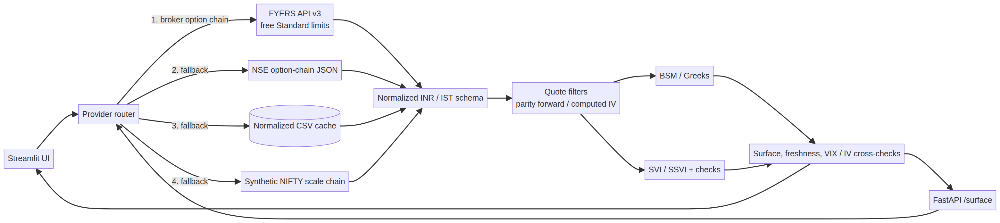

# Indian Options Implied-Volatility Surface

Python toolkit and Streamlit dashboard for fitting NSE-listed index and equity-option volatility surfaces. It includes a normalized NSE web-chain adapter, optional FYERS Standard-plan adapter, local cache, synthetic fallback, Black–Scholes–Merton IV solver, parity-regression forwards, per-expiry SVI, joint SSVI, and numerical arbitrage diagnostics.


> **Data note:** The checked-in JSON parser fixtures are synthetic, NSE-schema-shaped test data—not captured NSE quotes. NSE refused the live-chain request from the build environment, and a public NIFTY OI-only snapshot found during research was not a full quote chain. The fixtures are deliberately labeled to avoid implying real market data. Live or historical real-data validation remains pending access to an authorized data source.

## What is India-specific

- Underlying selector for NIFTY, BANKNIFTY, FINNIFTY, MIDCPNIFTY and sample liquid equities (RELIANCE, HDFCBANK, INFY, TCS, ICICIBANK); the API accepts any supported symbol.
- Prices are displayed in INR, all timestamps use `Asia/Kolkata`, and option expiry is valued at **15:30 IST** on the listed expiry date. ACT/365 is the default time basis and can be changed with `DAY_COUNT_BASIS`.
- Expiry dates are taken from the option chain, not inferred from a hard-coded weekday. Weekly/monthly labels are derived from the listed dates in each calendar month. Synthetic demo expiries are only illustrative.
- NSE index lot-size defaults are included for the current standard index contracts; an NSE response or `NSE_LOT_SIZES` configuration can override them. NSE may revise lot sizes: configure current stock lots from the current contract master where a feed does not supply them.
- India risk-free rate is a named, editable `INDIA_RISK_FREE_RATE` assumption (default `0.065`). Set it to the Indian 91-day T-bill yield, RBI repo rate, or other documented rate convention appropriate to your analysis.
- Index and stock quote screens use separate configurable thresholds. A least-squares put-call-parity regression estimates expiry forwards from matched near-ATM call/put mids. If parity data is too sparse, a logged spot/carry forward is used. Computed IV is used for fitting; vendor/exchange IV is kept separate for comparison only.
- Dashboard includes exchange-IV vs computed-IV error, snapshot timestamp/age, a configurable stale-feed alert, lot-size status, data source, an India VIX panel, and a 30-day ATM-IV comparison. NSE describes India VIX as a 30-calendar-day expected-volatility measure derived from NIFTY option bid/ask prices.
- NSE regular-hours logic uses 09:15–15:30 IST, weekdays, and a maintained 2026 holiday CSV. Update `data/nse_holidays.csv` each year and add exceptional closures in `NSE_HOLIDAYS_EXTRA`.

## Quick start (Windows)

```powershell
python -m venv .venv
.venv\Scripts\Activate.ps1
python -m pip install -e ".[dev]"
streamlit run app.py
```

Choose **Synthetic** for an offline demo or **Auto** to try the configured broker, then NSE, then local cache, then synthetic data. Recent successful broker/NSE snapshots are reused for `CHAIN_CACHE_TTL_SECONDS` (default 30 seconds) to avoid unnecessary requests; `refresh=true` bypasses that short live-cache window. NSE's website JSON endpoints are unofficial and may rate-limit or block automated requests; the app labels the actual source used. Do not treat cache/demo output as live prices.

### FYERS (optional broker source)

The FYERS v3 option-chain endpoint is used because the FYERS Standard API plan is documented as free and includes market-data access within usage limits. Create a FYERS API app in the [FYERS API dashboard](https://fyers.in/web/api-dashboard/user-apps), choose an individual app, follow the documented OAuth flow, then place its client ID and generated access token in a local `.env` copied from `.env.example`:

```dotenv
FYERS_CLIENT_ID=your-app-id-100
FYERS_ACCESS_TOKEN=your-daily-access-token
```

The access token expires daily at 06:30 and must be renewed through the FYERS authentication flow. Defaults map the four index selectors to FYERS index symbols; `FYERS_SYMBOL_MAP` can override these mappings or add equities (the adapter otherwise uses `NSE:<SYMBOL>-EQ`). The Standard plan currently documents 5 data requests/second, 50/minute, and 5,000/day; the adapter uses a conservative 0.25-second interval between expiry-chain requests. Confirm current plan limits and valid symbols in FYERS documentation. Never commit `.env` or expose tokens.

For NSE fallback, the adapter bootstraps a web session, sends browser-style headers, retries with bounded backoff, and rate-limits requests. If NSE denies access, use Auto (cache/synthetic fallback) or configure a broker/feed you are authorized to use. The fallback may be synthetic rather than live.

## API and Docker

```bash
uvicorn api.main:app --reload
curl 'http://127.0.0.1:8000/surface?symbol=NIFTY&source=synthetic&rate=0.065'
```

`GET /health` returns the service status and timezone. `GET /surface` accepts `symbol`, `source=auto|broker|nse|synthetic`, optional decimal annual `rate`, and `refresh=true`. The payload reports the requested and actual source, snapshot time/freshness and stale flag, lot size, India VIX when reachable, quote-quality counts, forwards, fitted SVI, and arbitrage checks.

```bash
cp .env.example .env   # optional: configure broker credentials/rates
docker compose up --build
```

Dashboard: `http://localhost:8501`; API docs: `http://localhost:8000/docs`.

## Architecture



The normalized provider schema feeds `core/pipeline.py`; pricing, SVI/SSVI, and diagnostics are shared by Streamlit and FastAPI. NSE/FYERS are optional live sources, and the fallback label is surfaced rather than hidden.

## Method

NSE index and single-stock options are European-style, so European Black–Scholes–Merton prices are inverted using a bracketed Brent solver. Index options are cash-settled; single-stock options are physically settled under NSE's individual-securities contract description. Settlement rules can change and are instrument-specific. With matched calls and puts, parity regression fits `C−P = DF(F−K)` to obtain a forward and discount factor; the implied dividend yield is inferred from the parity forward for pricing. Otherwise the pipeline logs and uses the configured-rate carry forward.

SVI fits total variance `w(k)` per expiry for `k=ln(K/F)`; the optional SSVI fit shares a shape across maturities. Calendar and butterfly checks sample a finite grid and are diagnostics, not continuous-domain proofs. The optional Dupire local-volatility helper can amplify quote noise. Near-expiry physical settlement can create delivery/funding obligations for stock options. This dashboard is for educational analytics, not trade execution or investment advice.

## Tests and quality

```bash
pytest -q
ruff check .
black --check .
```

Tests cover BSM/IV and SVI core behavior, NSE-shaped index and stock parsing, exchange IV normalization, ACT/365 expiry timing across the 15:30 close, holiday/weekend/session checks, parity regression, and configurable filters. Fixtures under `tests/fixtures/` are explicitly synthetic and are not suitable for model-quality claims. CI runs pytest and Ruff.

## Data-source and convention references

- [NSE equity-derivatives contract information](https://www.nseindia.com/static/products-services/equity-derivatives-contract-information) and [contract specifications](https://www.nseindia.com/static/products-services/equity-derivatives-contract-specifications): listed contracts, expiries, lot-size/contract-master references, and current conventions. Expiry rules can change; this implementation consumes expiry dates from the chain.
- NSE describes single-stock options as European and physically settled in its [individual-securities product notes](https://www.nseindia.com/static/products-services/equity-derivatives-individual-securities); the [settlement mechanism](https://www.nseindia.com/static/products-services/equity-derivatives-settlement-mechanism) describes European exercise and index-option settlement. Check the current instrument-specific contract before relying on settlement details.
- [NSE market timings and holidays](https://www.nseindia.com/resources/exchange-communication-holidays): maintain the local annual holiday CSV against the current exchange calendar. The included 2026 dates were cross-checked against [Groww's 2026 calendar](https://groww.in/p/nse-holidays); exceptional/special sessions need manual updates.
- [NSE India VIX methodology overview](https://www.nseindia.com/static/products-services/indices-indiavix-index): based on NIFTY option bid/ask prices and a 30-calendar-day horizon.
- [FYERS option-chain API](https://fyers.in/api-docs/v3/api/market-data/option-chain/), [Standard/Prime plans and limits](https://fyers.in/api-docs/v3/getting-started/plans-and-limits/), and [individual-app authentication](https://fyers.in/api-docs/v3/api/authentication/individual-app/): endpoint fields, the free Standard limit, OAuth token creation, and daily token expiry.
- [NSE copyright and permitted website content use](https://www.nseindia.com/nse-copyright): check NSE terms and market-data licensing before collecting, storing, redistributing, or using exchange data commercially. This repository does not include captured NSE market quotes.

## Known limitations

- NSE's site endpoints are unofficial, availability is IP/session-dependent, and an HTTP 403/changed payload can prevent live pulls. No NSE request succeeded from the authoring environment; live path is parser-tested but not live-validated here.
- FYERS Standard is free within documented request limits, but the user must have an FYERS account, create an app, and renew the daily token. Limits, API fields, and access policies can change.
- The included 2026 holiday dates need annual maintenance. Special sessions such as Muhurat trading are not modeled as open-session overrides.
- Lot sizes vary by underlying and can change. Index defaults may be overridden; populate current individual-stock lot sizes if absent from the selected response/instrument mapping.
- Parity estimates can be distorted by bid/ask noise, dividends, sparse matched strikes, and stale quotes. Filters are configurable, but not a substitute for exchange-quality feed checks.
- Data may be delayed or stale; snapshot age is shown and live/cache snapshots older than `MAX_CHAIN_AGE_SECONDS` trigger an alert. SVI fits can be unstable on thin/illiquid wings, especially when weekly and monthly expiry buckets are sparse. Arbitrage diagnostics sample finite points only; no result guarantees the absence of arbitrage.

## Roadmap

- Add a licensed, supported market-data feed with historical snapshots for reproducible live-data validation; keep the NSE website adapter as best-effort only.
- Add a maintained NSE instrument-master import for lot sizes, eligible symbols, and expiries, plus annual holiday-calendar refresh tooling.
- Expand robust surface fitting and liquidity-aware confidence diagnostics for sparse weekly expiries and illiquid wings.
- Add replay/backtest inputs from user-authorized data without checking large raw exchange dumps into the repository.

## License

MIT. See [LICENSE](LICENSE).
