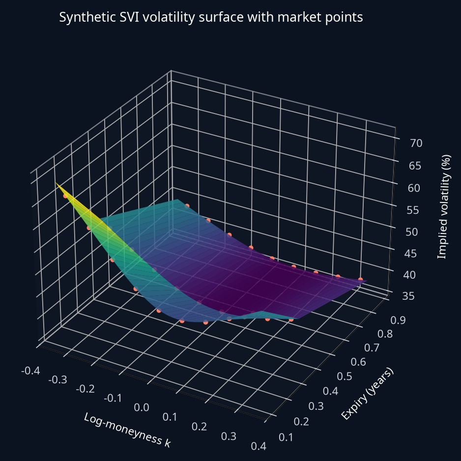

# Implied Volatility Surface Builder

A Python toolkit and interactive dashboard that turns option-chain quotes into implied volatility points, fits per-expiry raw SVI smiles (with a joint SSVI option), and visualizes the resulting surface with data-quality and static-arbitrage diagnostics.

## Highlights

- Yahoo Finance option-chain provider with a pluggable `ChainProvider` interface and local CSV cache/fallback.
- Deterministic offline demo quotes generated from known SVI surfaces.
- Black–Scholes prices, Greeks, no-arbitrage bounds, and Brent implied-volatility solver implemented with NumPy/SciPy.
- Mid-price filtering, spread/volume/open-interest screening, forward estimation using put-call parity when matching strikes exist, and OTM selection relative to the forward.
- SVI by expiry; optional SSVI global fit; numerical calendar and butterfly diagnostics; optional Dupire local-volatility helper.
- Streamlit dashboard with 3D fitted surface plus market points, smiles, term structure, heatmap, quality and arbitrage panels; FastAPI JSON endpoint.

## Quick start

```bash
python -m venv .venv
source .venv/bin/activate  # Windows: .venv\\Scripts\\activate
pip install -e '.[dev]'
streamlit run app.py
```

Open the displayed local URL. Choose **Synthetic demo** to work offline. Select **Yahoo Finance** and enter a symbol such as `SPY`, `AAPL`, or `TSLA` for live/delayed chain data. The app attempts to use `^IRX` for a 13-week Treasury proxy and falls back to 4% when unavailable; the rate is editable.

Run the API separately:

```bash
uvicorn api.main:app --reload
curl 'http://127.0.0.1:8000/surface?ticker=SPY&source=synthetic'
```

`GET /health` returns service status. `GET /surface` accepts `ticker`, `source=yfinance|synthetic`, optional annual `rate`, and `refresh=true` to bypass cache.

## Docker

```bash
docker compose up --build
```

Dashboard: `http://localhost:8501`; API: `http://localhost:8000/docs`. The Docker build includes both services; Compose starts them independently.

## Mathematics (brief)

For spot `S`, strike `K`, maturity `T`, rate `r`, dividend yield `q`, and volatility `σ`, Black–Scholes defines discounted European call and put values. Implied volatility is the root of model value minus observed mid-price. Brent's method is bracketed and quotes outside discounted intrinsic/upper bounds are rejected.

For expiry forward `F`, log-moneyness is `k=ln(K/F)` and total variance is `w=σ²T`. Raw SVI parameterizes a smile as `w(k)=a+b(ρ(k−m)+sqrt((k−m)²+σ²))`. SSVI constrains smiles through a shared shape and expiry-dependent ATM total variance. The app checks monotone total variance across observed maturities (calendar) and the nonnegative density factor implied by the butterfly condition over a finite log-moneyness grid. These checks are numerical approximations, not global proofs.

## Architecture

```text
Yahoo Finance / synthetic generator
               │
      data/provider.py ── local CSV cache
               │
      core/pipeline.py ── cleaning, forwards, IVs
         ┌─────┴─────┐
 core/pricing.py   core/svi.py ── SVI/SSVI & diagnostics
         │                 │
    core/local_vol.py      ├── app.py (Streamlit / Plotly)
                           └── api/main.py (FastAPI)
```



## Testing and quality

```bash
pytest -q
ruff check .
black --check .
```

GitHub Actions runs tests and Ruff on pushes and pull requests. See [CONTRIBUTING.md](CONTRIBUTING.md).

## Limitations

- Yahoo Finance is an unofficial, rate-limited source; quotes may be delayed, stale, or incomplete. Cached chains and synthetic data help with outages but are not a substitute for licensed real-time data.
- Black–Scholes pricing assumes European exercise. Many US equity and ETF options are American-style; early exercise, discrete dividends, and borrow effects can bias inferred IVs, parity forwards, and Greeks.
- Put-call parity forward inference requires matched call/put strikes; otherwise a rate-carry forward proxy is used. Dividends are represented only indirectly through parity/proxy and are not separately estimated.
- Filtering thresholds are generic and may need asset-specific configuration. Tiny prices and irregular expiries are delicate numerically.
- SVI fits can be underdetermined when the filtered smile is sparse. Arbitrage tests sample a finite grid and finite expiry set; they do not certify the entire continuous surface. Dupire derivatives amplify quote noise and are for exploration only.
- The dashboard is an analytics/education tool, not investment advice.

## Roadmap

- Add exchange- and vendor-specific adapters (Polygon, Alpha Vantage, NSE) and richer dividend/borrow curves.
- Improve SSVI parameter constraints, constrained arbitrage-free calibration, and fit diagnostics.
- Add configurable quote-screening policy, export formats, surface snapshots, and data freshness metadata.
- Expand local-volatility stability controls and test against benchmark datasets.

## License

MIT. See [LICENSE](LICENSE).
